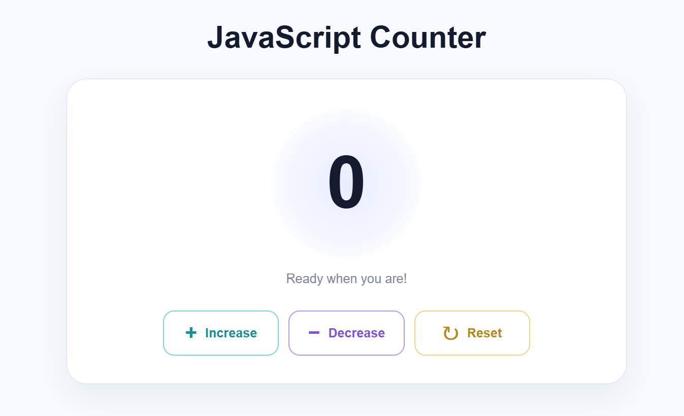

# JavaScript Projects

A collection of beginner-friendly JavaScript projects to practice programming fundamentals, DOM manipulation, events, and interactive UI development.

## 01. JavaScript Counter

A simple, responsive counter application built using **HTML, CSS, and JavaScript**.

### Preview

### Features

- Increase the counter by one.
- Decrease the counter by one.
- Reset the counter to zero.
- Display messages based on the current count.
- Smooth animation when the number changes.
- Responsive design for desktop and mobile screens.

### Technologies Used

- HTML5
- CSS3
- JavaScript (DOM manipulation and event listeners)

### How to Run

1. Clone this repository.
2. Open the `01-counter-project` folder.
3. Open `index.html` in your browser.

No additional packages are required.

---

More JavaScript projects will be added as I continue learning and practicing.
