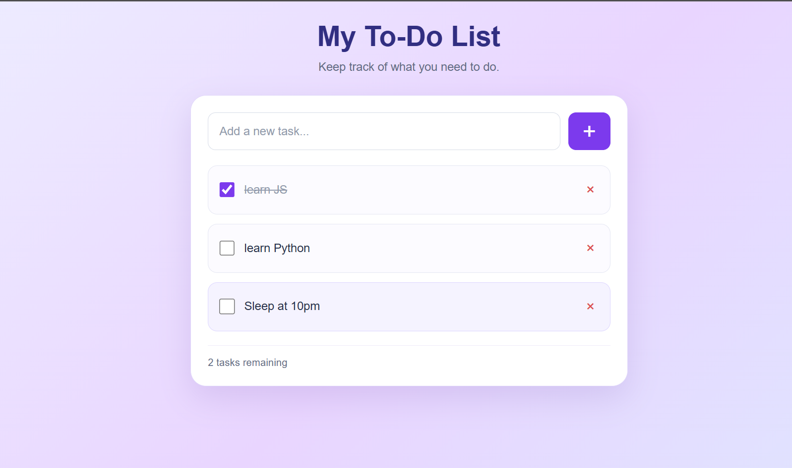

# 📝 To-Do List App

A simple, responsive, and user-friendly To-Do List application built using **HTML, CSS, and JavaScript**. This project helps users organize daily tasks, track completed work, and manage their to-do list through a clean interface with a beautiful lavender gradient background.

## ✨ Features

- ➕ **Add Tasks** — Add new tasks to your list.
- ✅ **Mark Tasks as Completed** — Check off tasks when finished.
- 🗑️ **Delete Tasks** — Remove tasks you no longer need.
- 💾 **Local Storage** — Tasks remain saved after refreshing or reopening the browser.
- 📱 **Responsive Design** — Works on desktop, tablet, and mobile screens.
- 🎨 **Modern UI** — Lavender gradient background, purple buttons, and a clean white card.
- ⌨️ **Keyboard Accessibility** — Visible focus indicators for buttons and input fields.

## 🛠️ Technologies Used

- HTML5
- CSS3
- JavaScript
- Browser Local Storage

## 📂 Project Structure

```text
02-todo-list/
├── images/
│   └── todo-list.png
├── index.html
├── style.css
├── script.js
└── README.md
```

## 📸 Screenshot



## 🚀 How to Run

1. Clone or download the repository.
2. Open the `02-todo-list` folder.
3. Open `index.html` in your browser.
4. Enter a task in the input field.
5. Click the **+** button to add it.
6. Use the checkbox to mark a task as completed.
7. Click the delete button to remove a task.

No additional packages or installation are required.

## 🎯 Learning Objectives

This project helped me practice:

- HTML structure and semantic elements.
- CSS Flexbox and responsive design.
- CSS gradients, hover effects, and transitions.
- JavaScript DOM manipulation and event handling.
- Managing task data with arrays.
- Saving and retrieving data using `localStorage`.

## 🔮 Future Improvements

- Edit existing tasks.
- Add due dates and task priorities.
- Filter tasks by All, Active, and Completed.
- Implement dark mode.
- Display task statistics and progress.

## 👨‍💻 Author

**Shivam**

This project is part of my JavaScript learning journey, focused on building practical projects and improving my frontend development skills.

---

⭐ If you find this project useful, consider giving the repository a star!
