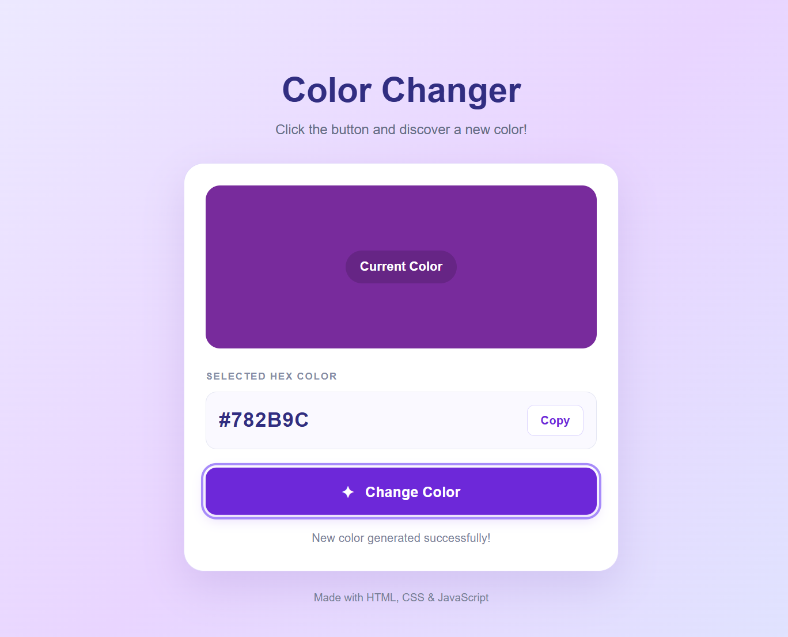

# 🎨 Color Changer

A fun and interactive Color Changer application built using **HTML, CSS, and JavaScript**. Generate random colors, preview them instantly, view their HEX values, and copy color codes with a single click.

## ✨ Features

- 🎲 **Random Color Generation** — Generate random HEX colors with a button click.
- 🌈 **Dynamic Color Preview** — Instantly update the color preview.
- 🔢 **HEX Color Display** — View the HEX code of the selected color.
- 📋 **Copy Color Code** — Copy the selected HEX value to the clipboard.
- ✨ **Smooth Transitions** — Enjoy smooth color transitions.
- 📱 **Responsive Design** — Works on desktop, tablet, and mobile devices.
- 💬 **User Feedback** — Displays messages when a color is generated or copied.

## 🛠️ Technologies Used

- **HTML5** — Structures the application.
- **CSS3** — Provides styling, gradients, transitions, and responsive layouts.
- **JavaScript** — Handles click events, random color generation, DOM manipulation, and clipboard operations.

## 📂 Project Structure

```text
03-color-changer/
├── images/
│   └── color-changer.png
├── index.html
├── style.css
├── script.js
└── README.md
```

## 📸 Screenshot



## 🚀 How to Run

1. Clone or download the repository.
2. Open the `03-color-changer` folder.
3. Open `index.html` in your web browser.
4. Click **Change Color** to generate a random color.
5. View the selected HEX color code.
6. Click **Copy** to copy the HEX value to your clipboard.

No additional packages or installation are required.

## 🎯 Learning Objectives

This project helped me practice:

- Handling JavaScript click events using `addEventListener()`.
- Generating random values using `Math.random()` and `Math.floor()`.
- Using strings and loops to generate HEX color codes.
- Selecting and updating HTML elements with the DOM.
- Changing CSS styles dynamically through JavaScript.
- Using the Clipboard API to copy text.
- Creating smooth CSS transitions and responsive layouts.

## 🔮 Future Improvements

- Add a collection of predefined colors.
- Prevent the same color from appearing consecutively.
- Add RGB and HSL color formats.
- Create a color history section.
- Add a button to generate random colors from a predefined palette.

## 👨‍💻 Author

**Shivam**

This project is part of my JavaScript learning journey, focused on building practical projects and improving my frontend development skills.

---

⭐ If you find this project useful, consider giving the repository a star!
