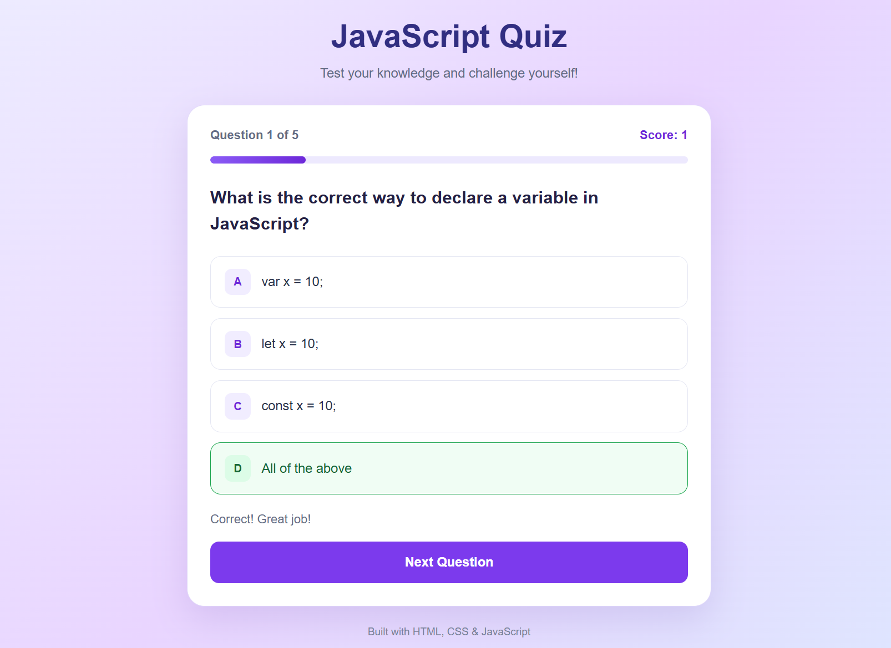

# 🧠 JavaScript Quiz App

A simple and interactive **JavaScript Quiz App** built using HTML, CSS, and JavaScript. Test your JavaScript knowledge by answering multiple-choice questions and checking your final score.

## ✨ Features

- 📝 Multiple-choice JavaScript questions
- ✅ Instant feedback for correct and incorrect answers
- 📊 Live score tracking
- 📈 Progress bar to track quiz progress
- 🎯 Final score and percentage
- 🔄 Restart quiz functionality
- 📱 Responsive design for mobile and desktop
- 🎨 Clean UI with a lavender and purple theme

## 🛠️ Technologies Used

- **HTML5** — Structures the quiz interface.
- **CSS3** — Styles the quiz and makes it responsive.
- **JavaScript** — Handles questions, answer checking, scoring, and results.

## 📂 Project Structure

```text
04-quiz-app/
├── index.html
├── style.css
├── script.js
├── README.md
└── images/
    └── quiz-app.png
```

## 🚀 How to Run

1. Clone or download this repository.
2. Open the `04-quiz-app` folder.
3. Open `index.html` in your browser.
4. Select an answer for each question.
5. Click **Next Question** to continue.
6. View your final score and click **Restart Quiz** to try again.

You can also open the project using the **Live Server** extension in Visual Studio Code.

## 📸 Screenshot

Add a screenshot of your quiz app to the `images` folder and name it `quiz-app.png`.



## 📚 What I Learned

- Accessing HTML elements using `getElementById()`
- Creating elements dynamically with `createElement()`
- Handling click events using `addEventListener()`
- Using arrays and objects to store quiz questions
- Writing functions and conditional statements
- Updating the DOM dynamically
- Tracking scores and calculating percentages
- Implementing quiz restart functionality

## 🔮 Future Improvements

- Add more questions and difficulty levels.
- Add a timer for each question.
- Store high scores using local storage.
- Add category-based quizzes.

---

⭐ If you like this project, consider giving the repository a star!

**Built with ❤️ using HTML, CSS, and JavaScript.**