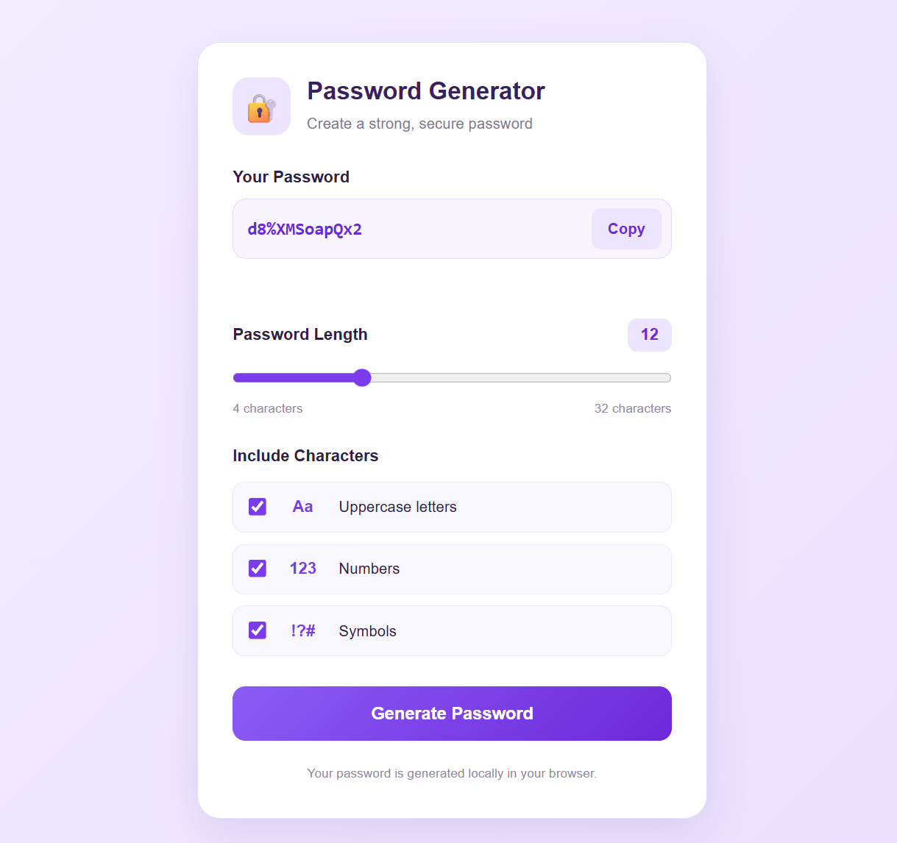

# 🔐 Password Generator

A simple and interactive **Password Generator** built using HTML, CSS, and JavaScript. Generate random passwords by choosing your preferred length and character types.

## ✨ Features

- 🔑 Generate random passwords
- 📏 Adjust password length from 4 to 32 characters
- 🔠 Include uppercase letters
- 🔢 Include numbers
- 🔣 Include symbols
- 📋 Copy passwords to the clipboard with one click
- 🎨 Clean lavender-and-purple user interface
- 📱 Responsive design for mobile and desktop

## 🛠️ Technologies Used

- **HTML5** — Creates the application structure.
- **CSS3** — Styles the interface and makes it responsive.
- **JavaScript** — Handles password generation, checkbox selections, and clipboard actions.
- **Web Crypto API** — Provides cryptographically secure random values for character selection.

## 📂 Project Structure

```text
05-password-generator/
├── index.html
├── style.css
├── script.js
├── README.md
└── images/
    └── password-generator.png
```

## 🚀 How to Run

1. Clone or download this repository.
2. Open the `05-password-generator` folder in Visual Studio Code.
3. Open `index.html` using the Live Server extension.
4. Choose your preferred password length.
5. Select the character types you want to include.
6. Click **Generate Password**.
7. Click **Copy** to copy your password.

## 📸 Screenshot

Add a screenshot of your application to the `images` folder and name it `password-generator.png`.



## 📚 What I Learned

- Selecting HTML elements using `getElementById()`
- Handling button clicks with `addEventListener()`
- Using variables, strings, and functions
- Applying `if` statements and `for` loops
- Reading checkbox values using `.checked`
- Updating HTML elements using `.textContent` and `.value`
- Generating random values using the Web Crypto API
- Copying text using the Clipboard API

## 🔮 Future Improvements

- Ensure every selected character type appears at least once.
- Add a password strength indicator.
- Add a button to show or hide the password.
- Add an option to exclude similar characters, such as `0` and `O`.
- Improve password generation with unbiased random selection.

---

⭐ If you like this project, consider giving the repository a star!

**Built with ❤️ using HTML, CSS, and JavaScript.**